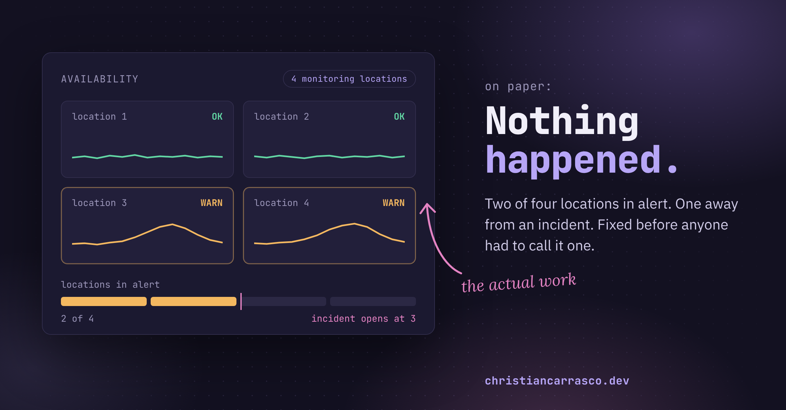

*Why I built a site to show work that nobody was supposed to notice in the first place.*

This is the fourth version of this post. One was all about me, one had a kitchen metaphor (don't ask), and one sat in drafts until it went stale. So here's the plain version.

The best status report in IT operations is two words long. Nothing happened.

No outage, no 2 a.m. bridge call, nobody senior asking for a timeline. I spent five years at Beyondsoft Consulting doing incident management for Toyota, the last three running the team, and our best days looked like nothing at all. I'm still proud of those days. I also can't show you a single one of them.

That second part took me longer to notice than it should have.

## Why this is a weird job to be good at

A developer ships a feature and can point at it. Sales closes a deal and there's a number. Ops? The win is that a thing didn't occur, and you can't screenshot something not occurring. (I've thought about it. A screenshot of a quiet dashboard just looks like a screenshot.)

And it gets worse the better you get. Fix something at 3 a.m. and you're a hero for a week. Prevent it three weeks earlier with a boring config change and nobody knows there was a thing. Your best work leaves the least behind.

And whatever does get written down isn't yours. Runbooks, dashboards, incident reviews, all behind the company's login, which is exactly where they should stay. Add that up over ten-plus years (help desk, systems support at a healthcare company, a security analyst seat, then ops) and I walked away with a lot of results and pretty much nothing I could hand to another person.

## The Y2K problem

Y2K might be the most successful IT project ever. Thousands of people spent years fixing code so the clocks could roll over without incident. They did, and nothing happened. Plenty of people now remember it as a hoax.

That's the deal in this line of work. Do the job well enough and it looks like there was never a job to do. We keep the fire stories and lose the saves.

## The part that's on me

Some of that is just the job. The rest is on me.

I never stopped learning. Infrastructure support, then cybersecurity, then operations, and every move meant picking up something new. What I stopped doing was keeping a record of it. I didn't write things down for myself. I didn't build anything in public that another employer could look at. And somewhere along the way, I let my certifications lapse.

I know certs aren't the whole story. But they're one of the few signals HR and recruiters can read in a few seconds, and a current one says this person takes his career seriously and is still learning. An expired one says the opposite, even when it isn't true.

So I'm fixing both. SSCP is on the calendar and CISSP is next, and this site is the record I should have been keeping all along.

## What I'd tell myself ten years ago

Two things I wish I'd done the whole time, and one I've only just started.

Write down the decision before you know how it turns out. What you picked, what you passed on, why. Two lines, because if the rule is "write a proper document" you'll do it once and never again. Hindsight rewrites everything.

Record the save too, and not only the fire. This one happened to me more times than I can count. Early morning, I'd take a peek at the APM tool and find two of our four monitoring locations in alert. The incident threshold was three. One more location and it's a full incident, bridge call and all. So I'd pull the dev teams in right then and get it fixed while it was still a warning. On paper, nothing happened.

Those are the ones to write down, with a rough guess at what they would have cost. "Caught it early" is an anecdote. "Caught it early, and here's roughly what the incident would have cost" is a result.

(Keep them generic enough that the notes can leave the building with you. This is a security site, after all.)

Then the one I'm new at. Own something end to end outside of work. Small is fine, as long as every call and every mistake is yours, and you're allowed to show all of it.

## So, this site

It's my "own something" thing.

There's a home lab. It runs on my old gaming desktop, which has been retired from gaming and wasn't consulted. On it lives a very small pretend company: a domain controller, a few Windows and Linux machines, a firewall, and a network carved into segments. That company is wired to a Microsoft 365 tenant running Defender XDR, Sentinel, and Purview, with Entra ID holding the whole thing together.

I will write up what I do with it, including the parts that go badly. I've already changed my mind on the lab's direction more times than I'd like to admit, mostly before installing anything. I also own a firewall that turned out to need a paid license before it will pass a single packet, which I will likely sell and put into my RAM upgrade piggy bank.

## Next

The foundation is going in now, and the Microsoft tenant goes on top of it. Then four projects, each ending in a writeup. Endpoint and email defense. Exposure and vulnerability management, where every finding gets an owner, a date, and somebody who follows up, because I'm still an ops person. SOC detections written in KQL. And Purview data protection and compliance.

In between, the blog gets the shorter stuff like certification updates, or the next post "why I didn't buy a used Dell server Rack".

If you do this work, follow along and skip a few of my mistakes. If you hire for it, this is a running record of how I work through a problem, which a resume can't carry. New posts land here and on LinkedIn the same day.

And if I've got something wrong, say so. I'd rather hear it from you than find out in production.

If any of this sounds familiar, come find me on LinkedIn and bring a save of your own, because I'd love to hear the ones nobody else did.
